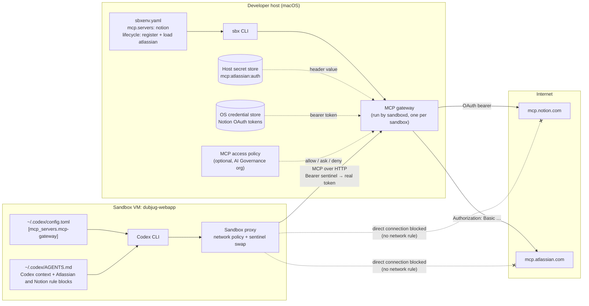
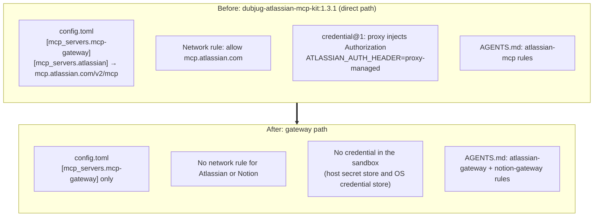
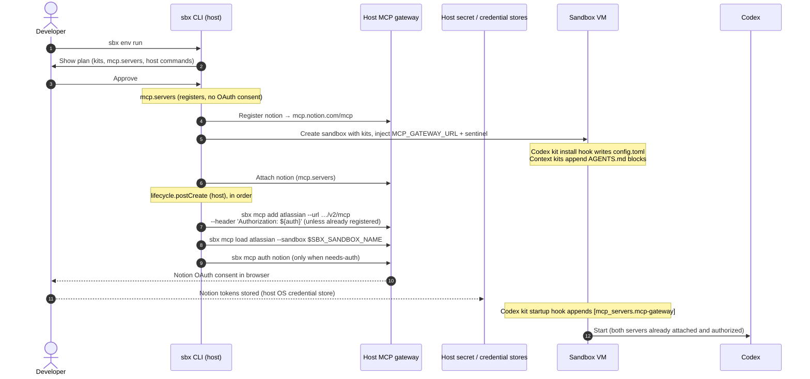

# MCP gateway architecture for the DUBJUG sandbox

Status: implemented and verified 5 Nov 2026 (sbx v0.51.0). Originally the
target design written before implementation; updated to the lab outcomes.
Evidence for every claim is indexed in `RESULTS.md`. Statements marked
**confirmed** were read from the published `docker.io/docker/sbx-kit-codex:0.162.1`
descriptor (manifest annotation `vnd.docker.sandbox.kit.descriptor`).

## 1. Summary

The Codex agent in the `dubjug-webapp` sandbox reaches two hosted MCP servers,
Notion and Atlassian Cloud, only through the sandbox's MCP gateway. The gateway is
run by `sandboxd` on the developer's host. The sandbox never connects to either
server, and no upstream credential ever enters the sandbox.

| Server | Endpoint | Auth | Registered by | Attached by |
| --- | --- | --- | --- | --- |
| Notion | `https://mcp.notion.com/mcp` | OAuth (path A); tokens in the host OS credential store | `sbxenv.yaml` `mcp.servers` | `sbxenv.yaml` `mcp.servers` |
| Atlassian | `https://mcp.atlassian.com/v2/mcp` | Scoped API token as a header (path B); secret `mcp:atlassian:auth` in the host secret store | `sbxenv.yaml` `lifecycle.postCreate` host command (register-if-missing) | `sbxenv.yaml` `lifecycle.postCreate` host command (`sbx mcp load`) |
| dataserver | `http://127.0.0.1:8000/mcp` (local HTTP server on the developer's host) | Bearer token as a header (path B); secret `mcp:dataserver:auth` | Same postCreate pattern as Atlassian, plus `--skip-ssrf-check` for the loopback URL; warns instead of failing when the server is down | Same (`sbx mcp load`) |

All host commands live in `postCreate`, none in `initialize`: `initialize`
runs on every `sbx env run`, `postCreate` only at create. (The prompt-per-run
problem this was meant to fix turned out to need `env.rememberHostCommands`
anyway; see R5.) Notion's OAuth consent also runs at create, as a `postCreate`
command (`sbx mcp auth notion`, guarded by a needs-auth check), because
`mcp.servers` registers without running consent and sign-in started from
inside the sandbox does not deliver a usable token.

Codex itself is configured with exactly one MCP server, `mcp-gateway`. It learns
about Notion and Atlassian only from the tool list the gateway returns.

## 2. Components and trust boundaries



What crosses each boundary:

- **Sandbox → host gateway:** MCP requests that carry a sentinel bearer token.
  The sandbox proxy swaps the sentinel for the real gateway token, so the real
  token never exists inside the VM.
- **Host gateway → upstream:** the gateway adds each server's credential (Notion
  OAuth token, Atlassian header) on the host.
- **Sandbox → upstream directly:** denied. Neither `mcp.notion.com` nor
  `mcp.atlassian.com` appears in any network rule, whether kit-level or
  environment-level. Their absence is part of what the demo proves.

## 3. How Codex is configured

Docker's Codex workload kit already contains everything Codex needs. No kit of
ours touches Codex's MCP config.

### 3.1 Runtime-injected variables

When the sandbox is created, the runtime injects:

| Variable | Meaning |
| --- | --- |
| `MCP_GATEWAY_URL` | URL of this sandbox's gateway on the host |
| `MCP_SENTINEL_TOKEN_NAME` | Placeholder bearer token; the proxy swaps it for the real one |

These names are not on docs.docker.com. They are what the Codex and Claude v3
kits read. Verified inside the sandbox: both set, and no `ATLASSIAN_AUTH_HEADER`.

### 3.2 Codex kit hooks (confirmed)

`sbx-kit-codex:0.162.1` has two `lifecycle@1` hooks that matter here:

1. **Install hook.** Creates `~/.codex/config.toml` from scratch with `cat >`
   and seeds the model, auth mode, `mcp_oauth_credentials_store = "file"`, and
   workspace trust. Because the file is overwritten, a mixin that edits it would
   lose its changes. This is why our kits never write to it.
2. **Startup hook.** If `MCP_GATEWAY_URL` is set and the gateway table is not
   already in the file, the hook appends:

   ```toml
   [mcp_servers.mcp-gateway]
   url = "<MCP_GATEWAY_URL>"
   http_headers = { Authorization = "Bearer <MCP_SENTINEL_TOKEN_NAME>" }
   ```

   The hook's own comment explains why it uses `http_headers` and not a
   `[...headers]` sub-table: Codex does not read the sub-table form, and the
   gateway would then be reached without its token.

The kit also declares `agent-context@1`, which writes Docker's Codex context to
`~/.codex/AGENTS.md`.

### 3.3 Our context kits

The two declaration-only mixins carry rules and nothing else:

| Kit | Adds | Does not add |
| --- | --- | --- |
| `dubjug-atlassian-context-kit:1.0.0` (arg `site`) | Marker-guarded `atlassian-gateway` block appended to `~/.codex/AGENTS.md`; inline `agent-context@1` | Network rule, credential, MCP registration, any write to `config.toml` |
| `dubjug-notion-context-kit:1.0.1` | Marker-guarded `notion-gateway` block appended to `~/.codex/AGENTS.md`; inline `agent-context@1` | Same |
| `dubjug-dataserver-context-kit:1.0.0` | Marker-guarded `dataserver-gateway` block; inline `agent-context@1` (the seven read-only analysis tools, inline-dataset usage, not-attached recovery) | Same |

The Atlassian rules are written for header auth, so there is no
`atlassian-authorize` step. On 401/403 the agent stops and tells the user to run
`sbx secret set mcp:atlassian:auth` and restart the sandbox. The Notion rules
(1.0.1) forbid calling `notion-authorize`: while Notion is unauthorized the
gateway hides every Notion tool and offers only `notion-authorize` (there is no
401 — the tools are simply absent), and sign-in started from inside the sandbox
does not produce a usable token. The agent instead tells the user to run
`sbx mcp auth notion` on the host and start a new agent session, because a
running session does not pick up tools granted after it started.

### 3.4 Resulting configuration



`dubjug-atlassian-mcp-kit:1.3.1` stays published, unchanged, as the "before"
state for the demo.

## 4. Lifecycle: from `sbx env run` to a ready agent



Verified ordering (R1): all `postCreate` commands complete before the workload
starts Codex, so the first session's tool list already has both servers.

Developer credential step for Atlassian, once per machine, **before the first
run**: `sbx secret set mcp:atlassian:auth` (paste `Basic base64(email:api_token)`
with a scoped token for the "Atlassian MCP V2" app). Verified: the secret can be
stored before the server is registered; the later registration binds to it
immediately (`ready`, `${auth}: (set)`), with no restart. Only a secret changed
*after* the gateway is running needs a sandbox or sandboxd restart. A developer
who skips this sees `sbx mcp ls` name the exact `sbx secret set` command as the
next step.

## 5. Discovery and tool calls through the gateway

```mermaid
sequenceDiagram
  autonumber
  participant Codex
  participant Proxy as Sandbox proxy
  participant GW as Host MCP gateway
  participant Pol as MCP policy
  participant N as mcp.notion.com
  participant A as mcp.atlassian.com

  Codex->>Proxy: initialize + tools/list (Bearer sentinel)
  Proxy->>GW: Same request, real gateway token
  GW->>N: tools/list (OAuth bearer)
  GW->>A: tools/list (Authorization header)
  N-->>GW: Notion tools
  A-->>GW: Atlassian tools
  GW-->>Codex: Merged tool list + gateway tools<br/>(static: mcp-exec, code-mode; dynamic: also mcp-find, mcp-add, mcp-config-set)

  Codex->>GW: tools/call searchJiraIssuesUsingJql
  GW->>Pol: invokeTool atlassian / readOnly?
  Pol-->>GW: permit
  GW->>A: tools/call
  A-->>GW: Result
  GW-->>Codex: Result

  Note over Codex,GW: Live attach: sbx mcp load / unload changes the attached set.<br/>The gateway advertises tools/listChanged, but Codex 0.162 does not refresh:<br/>tools granted after a session starts appear only in a new session.
```

Key points:

- Codex sees one server, `mcp-gateway`. Notion and Atlassian are not visible as
  separate servers in its config. They are told apart only by tool names in the
  merged list.
- Tool names are **bare** upstream names (`mcp.useServerNamePrefixes` defaults
  to `false`): Atlassian tools arrive as `searchJiraIssuesUsingJql`, `discover`,
  `executeRead`; Notion's own names all start `notion-`, so there are no
  collisions (verified across all 106 tools). Codex qualifies them as
  `mcp__mcp_gateway__<tool>` (hyphens become underscores) and logs them as
  `mcp-gateway/<tool>`.
- The mode is **static**: with `mcp.servers` plus `sbx mcp load`, the gateway
  exposes the servers' tools plus `mcp-exec` and `code-mode`, but not
  `mcp-find`, `mcp-add` or `mcp-config-set`.
- Codex 0.162 defers MCP tools (tool search): asked to list its tools it may
  say none. A real inventory has to come from a direct gateway session.
- The Atlassian tool set must not use `?tools=all`. Without it the server lists
  about 20 tools plus `discover` and `executeRead`/`executeWrite`/`executeDestructive`,
  which keeps `searchJiraIssuesUsingJql` within Codex's tool limit (learned in 1.3.1).
- If an MCP access policy is in force, the gateway checks every registration and
  every tool call against it. A direct connection from the VM would bypass this,
  which is why the network rules must not allow the upstream hosts.

## 6. Risks and open questions — all resolved

| # | Item | Outcome |
| --- | --- | --- |
| R1 | **Late attach of Atlassian.** | Resolved: `postCreate` completes before the workload starts Codex, so the first session already has the tools. The remaining late-attach case is a server authorized *after* Codex starts: the gateway advertises `tools/listChanged` but Codex 0.162 does not refresh, so the fix is a new session (the Notion kit rule says so). |
| R2 | **Tool name shape.** | Resolved: bare upstream names; Codex shows `mcp__mcp_gateway__<tool>`. Kit text matches. |
| R3 | **Two writers of `~/.codex/AGENTS.md`.** | Resolved: both marker blocks appear exactly once in a live sandbox and the workload's own context is intact. The mixin `agent-context@1` content is also reachable (Codex opened the side file in the TUI). |
| R4 | **Static vs dynamic mode.** | Resolved: static. No `mcp-find`/`mcp-add`/`mcp-config-set`. |
| R5 | **Approval on every run.** | Resolved, unfavourably: even a postCreate-only plan with nothing changed prompts on every `sbx env run`, because host commands are *declared* ("needs explicit approval on each run"). The only prompt-free path for a bare `sbx env run` is `sbx settings set env.rememberHostCommands true` (per machine, MDM-able, remembered until the command text changes; MCP approval then also covers gateway restarts). Alternatives per run: `--force`, `--skip-host-commands`. |
| R6 | **Name conflict** (`mcp.servers` entry vs header registration of the same name). | Avoided by design: `atlassian` stays out of `mcp.servers`. Not tested. |
| R7 | **Local vs hosted gateway.** | Resolved: local for this account; `mcp.forceLocalGateway` not needed. |
| R8 | **`sbx mcp ls --json` shape.** | Resolved: pretty-printed array with top-level `"name"`; the guard `grep -Eq '"name": *"atlassian"'` is exact, no `jq` needed. |

One operational gotcha outside the table: **`sbx env run` reuses an existing
sandbox and does not apply kit changes or `postCreate` to it** (the plan marks
them "waits for the next create"). Anyone holding a pre-gateway `dubjug-webapp`
sandbox must `sbx env rm` once.

## 7. Developer contract

The developer:

1. Clones the repository.
2. Stores their Atlassian API token once per machine, before the first run:
   `sbx secret set mcp:atlassian:auth` (no restart needed when set first).
3. Runs `sbx env run` and approves the plan.
4. Approves the Notion browser sign-in that opens during the create.

The developer never runs `sbx mcp add`, `sbx mcp load`, `--static-mcp`, or
edits any config file. Every registration and attachment is declared in
`sbxenv.yaml`. If Notion sign-in is skipped at create, the recovery is
`sbx mcp auth notion` plus a new agent session.

## 8. References

- Handoff: `dubjug-mcp-gateway-handoff.md` (5 Nov 2026)
- MCP gateway: https://docs.docker.com/ai/sandboxes/mcp-gateway/
- Environment files: https://docs.docker.com/ai/sandboxes/configuration/environment-files/
- MCP access policies: https://docs.docker.com/ai/sandboxes/governance/access-controls/mcp/
- MCP policy reference: https://docs.docker.com/ai/sandboxes/governance/reference/mcp-policy/
- Codex v3 workload spec: https://github.com/docker/sandbox-kit-spec/blob/main/examples/codex/codex.yaml
- Atlassian Remote MCP Server with other clients: https://support.atlassian.com/rovo/docs/using-with-other-supported-mcp-clients
